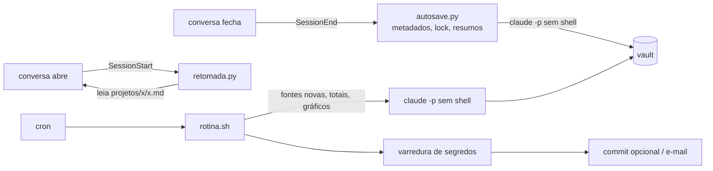

# claude-brain

Memória de longo prazo para o [Claude Code](https://docs.claude.com/en/docs/claude-code) num
vault Markdown (compatível com Obsidian), com automação que roda sem shell.

## O problema

Cada conversa com um assistente de código começa do zero. O que foi decidido ontem, o que falhou
e por quê, onde o projeto parou: isso fica numa transcrição longa que ninguém relê. Escrever a
nota à mão no fim de cada conversa funciona por uma semana. E quando a conversa é retomada dias
depois, o assistente não sabe que existe uma nota nem quanto tempo passou.

## O que faz

- **Autosave (hook SessionEnd)** — quando uma conversa fecha, reabre-a em segundo plano
  (`claude -p --resume`) e grava um resumo destilado no vault: uma entrada por dia no
  `Registro <projeto>.md`, notas de tema para frentes que se repetem e o estado atual na nota do
  projeto. Opt-in por pasta.
- **Retomada (hook SessionStart)** — ao abrir ou retomar uma conversa, acha a nota cujo `pasta:`
  contém o diretório atual e avisa o assistente (e você) para lê-la.
- **Rotina diária** — lê as fontes que mudaram (diários, notas externas) e atualiza uma análise
  de padrões; no dia configurado, escreve um relatório semanal com gráficos e envia por e-mail.
- **Sessões de foco** — uma tabela Markdown de sessões de trabalho concentrado; `foco.py` dá
  totais por dia/semana/categoria, alvos, melhores marcas e ritmo; `grafico.py` gera os gráficos.
- **Segurança por desenho** — as sessões sem humano só têm Read/Edit/Write presos a caminhos
  declarados; tudo que precisa de programa roda antes ou depois, em Python testado.



Detalhes em [docs/arquitetura.md](docs/arquitetura.md).

## Instalação

Requisitos: Python ≥ 3.11, Claude Code instalado e autenticado, Linux ou macOS (Windows via WSL).

```bash
git clone <url-deste-repositorio> claude-brain   # num caminho sem espaço nem vírgula (ver Limitações)
cd claude-brain
python3 -m venv .venv                    # ou: uv venv .venv
.venv/bin/pip install -r requirements-dev.txt
cp config.example.toml config.toml
$EDITOR config.toml                      # raizes, vault, autosave.pastas, fontes, foco, e-mail
.venv/bin/pytest -q && .venv/bin/ruff check .
```

### Experimente no vault fictício

Tudo abaixo escreve só dentro de `exemplo/saida/` (ignorado pelo git): vault de cópia, estado,
logs e locks. `--dry-run` imprime o comando do `claude` e o pedido sem executar nada.

```bash
.venv/bin/python exemplo/gerar_dados.py            # cria exemplo/saida/
C=exemplo/saida/config.toml
.venv/bin/python scripts/foco.py --config $C ritmo --agora 2030-04-10T21:40
.venv/bin/python scripts/grafico.py --config $C semana 2030-04-08 --saida exemplo/saida/graficos
.venv/bin/python scripts/enviar_email.py --config $C --dry-run \
  "exemplo/saida/vault/analise/relatorios/Relatorio 2030-W14 semanal.md"
.venv/bin/python hooks/autosave.py --config $C --dry-run < exemplo/saida/payload.json
CLAUDE_BRAIN_PYTHON=.venv/bin/python scripts/rotina.sh --config $C --dry-run --agora 2030-04-15T21:00
```

### Registrar os hooks

Em `~/.claude/settings.json` (troque o caminho pelo do seu clone):

```json
{
  "hooks": {
    "SessionStart": [
      { "hooks": [ { "type": "command",
                     "command": "python3 -I /caminho/para/claude-brain/hooks/retomada.py" } ] }
    ],
    "SessionEnd": [
      { "hooks": [ { "type": "command",
                     "command": "python3 -I /caminho/para/claude-brain/hooks/autosave.py" } ] }
    ]
  }
}
```

Os hooks leem `config.toml` da raiz do repositório (ou `$CLAUDE_BRAIN_CONFIG`). O autosave só
age em conversas abertas dentro de `autosave.pastas`. Para desligar numa sessão:
`CLAUDE_BRAIN_SEM_AUTOSAVE=1` / `CLAUDE_BRAIN_SEM_RETOMADA=1`.

### Agendar a rotina

cron (todo dia às 21:00):

```cron
0 21 * * * /caminho/para/claude-brain/scripts/rotina.sh
```

systemd (usuário), que também roda ao ligar a máquina se o horário passou:

```ini
# ~/.config/systemd/user/claude-brain.service
[Service]
Type=oneshot
ExecStart=/caminho/para/claude-brain/scripts/rotina.sh

# ~/.config/systemd/user/claude-brain.timer
[Timer]
OnCalendar=*-*-* 21:00
Persistent=true
[Install]
WantedBy=timers.target
```

`systemctl --user enable --now claude-brain.timer`. O `rotina.sh` se limita a
3 × `rotina.tempo_max_s` + 5 min (troque com `CLAUDE_BRAIN_TIMEOUT`); se o tempo estourar, a
rotina registra FALHA e notifica antes de sair. A senha SMTP vem de variável de ambiente
(`Environment=` num drop-in com permissão 0600), keyring ou arquivo 0600; ela não é repassada à
sessão do Claude.

### Sessões de foco

```bash
.venv/bin/python scripts/foco.py registrar codigo              # sessão com a duração padrão
.venv/bin/python scripts/foco.py registrar leitura --minutos 15
.venv/bin/python scripts/foco.py ritmo                         # alvo do dia e da semana, melhores marcas
```

O dia de foco termina na `virada_hora` (padrão 04:00): uma sessão que acaba à 00:40 entra com a
data do dia anterior e a hora real, e conta para aquele dia.

## Segurança em 5 linhas

1. Sessões automáticas: `--restricted`, `--tools Read,Edit,Write`, escrita só em caminhos
   declarados, nada oculto nem `CLAUDE.md`, `dontAsk`, sem MCP, sem settings do usuário.
2. Conteúdo lido é tratado como dado; o aviso da retomada é visível; caminhos são validados
   contra raízes configuradas.
3. Retrato do vault inteiro antes e depois, sob um lock único: mudança em caminho que executa ou
   instrui (plugins, hooks do git, CLAUDE.md, AGENTS.md) ou sem o marcador da conversa é FALHA;
   exceções viram FALHA notificada, nunca morte silenciosa.
4. Varredura antes de commit/e-mail: segredos e conteúdo que plugin do Obsidian executa
   (dataviewjs, JS inline do Dataview, Templater); só o que a sessão acrescentou bloqueia; commit só dos
   arquivos gerados; pendências retentadas; temporários 0600; logs só com status.
5. E-mail com TLS verificado, sem HTML cru, sem links clicáveis e só com imagens locais por `cid:`.

Modelo de ameaça, controles e o que falta confirmar: [docs/seguranca.md](docs/seguranca.md).

## Limitações

- Depende de flags do Claude Code (`--restricted`, `--fork-session`, `--no-session-persistence`,
  `--system-prompt-snapshot`); os testes conferem que existem no `--help` e que o comando é
  montado certo, mas não chamam a API. Veja a lista "A confirmar com execução real" em
  [docs/seguranca.md](docs/seguranca.md).
- O formato da transcrição do Claude Code não é uma API pública; `conversa.py` pode precisar de
  ajuste em versões futuras.
- A qualidade do resumo é a do modelo. A pós-condição garante que a nota certa foi escrita, não
  que está boa.
- A varredura é por padrão textual: pega formatos de segredo e sintaxes de plugin conhecidos,
  não intenção nem plugin desconhecido.
- Mudança alheia no vault durante uma sessão automática (plugins, edição à mão) vira AVISO no
  log; só caminhos que executam ou instruem geram FALHA.
- Caminhos que viram regra de permissão (vault, caminhos de escrita, pasta de análise, fontes, o
  próprio clone deste repositório e a pasta temporária `TMPDIR`) não podem ter espaço nem vírgula:
  a configuração recusa com mensagem clara, e a sessão automática não roda.
- Testado em Linux; macOS deve funcionar (o `rotina.sh` precisa de `flock` e `timeout`).

## O que aprendi

- **Permissão por lista de negação não segura agente sem humano.** Liberar o shell com uma lista
  de comandos permitidos e outra de proibidos sempre deixa um caminho novo. O que fecha a classe
  inteira é tirar o shell e mover todo comando para antes ou depois da sessão.
- **Escrever em arquivo também executa código.** Um editor que carrega plugins de uma pasta oculta
  transforma "pode editar o vault" em "pode rodar código". Escrita precisa de lista de caminhos,
  não de uma pasta raiz.
- **Pós-condição vale mais que código de saída.** "Terminou com 0" e "escreveu o que devia" são
  coisas diferentes; exigir a nota com o marcador da conversa pegou falhas silenciosas.
- **Um parser só.** Dois scripts lendo a mesma tabela divergem nos casos de borda; unificar e
  validar linha a linha resolveu e deu mensagens de erro úteis.
- **Convenção de nota é interface.** O marcador `%% sessões %%` e o `pasta:` no frontmatter ligam
  conversa, código e vault; tratá-los como contrato (validado e testado) evitou que uma nota mal
  escrita quebrasse os hooks.
- **Especificar antes evitou construir o servidor errado.** Ver [docs/metodo.md](docs/metodo.md).

## Licença

MIT — ver [LICENSE](LICENSE).
