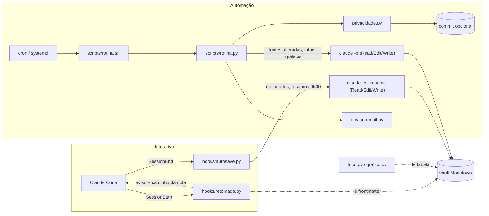

# Arquitetura

## Visão geral



Regra de desenho: **o que é determinístico roda em Python; o modelo só destila texto.** Contar,
validar, achar arquivo, gerar gráfico, varrer segredo, conferir o que mudou, commitar e enviar
e-mail nunca passam pelo modelo. Isso deixa as sessões automáticas sem shell (ver
[seguranca.md](seguranca.md)) e torna o resto testável sem chamar a API.

## Componentes

| Arquivo | Papel | Dependências |
|---|---|---|
| `hooks/retomada.py` | SessionStart: acha a nota cuja `pasta:` contém o cwd e injeta um aviso curto | stdlib |
| `hooks/autosave.py` | SessionEnd: valida, destaca, trava, calcula metadados, chama o modelo, confere | stdlib |
| `scripts/comum.py` | configuração (`tomllib`), validação de caminho por raízes, gravação atômica, lock, log | stdlib |
| `scripts/vault.py` | frontmatter, nota pelo cwd, notas que citam uma conversa, links para fora, retrato | stdlib |
| `scripts/conversa.py` | lê a transcrição do Claude Code: pedidos, dias, resumo de um dia | stdlib |
| `scripts/claude_cmd.py` | monta e roda o `claude -p` restrito; interpreta a saída JSON | stdlib |
| `scripts/privacidade.py` | varredura de segredos e termos proibidos | stdlib |
| `scripts/notificar.py` | notificação de desktop opcional | stdlib |
| `scripts/foco.py` | parser da tabela de sessões, totais, alvos, melhores marcas, ritmo, registro | stdlib |
| `scripts/grafico.py` | resumo e PNGs por semana/mês | matplotlib |
| `scripts/enviar_email.py` | Markdown → HTML seguro, SMTP com TLS | markdown |
| `scripts/rotina.py` / `rotina.sh` | rotina diária; o `.sh` só garante lock e tempo máximo | as acima |
| `skills/*/SKILL.md` | instruções que o modelo lê pelo caminho | — |

Os hooks importam só módulos de biblioteca padrão: rodam com o `python3` do sistema, sem venv.

## Fluxo do autosave

```mermaid
sequenceDiagram
  participant CC as Claude Code
  participant H as autosave.py (hook)
  participant F as autosave.py (processo destacado)
  participant C as claude -p
  CC->>H: SessionEnd (payload JSON no stdin)
  H->>H: desligado? cwd no opt-in? id e transcrição válidos?
  H->>F: Popen destacado, payload pelo stdin
  H-->>CC: sai em milissegundos
  F->>F: espera o Claude Code sair; lock do vault (o mesmo da rotina)
  F->>F: pedidos novos desde a última tentativa (transcrição)
  F->>F: link simbólico inseguro nos caminhos de escrita? recusa
  F->>F: metadados + resumos dos dias antigos (tmp 0600)
  F->>F: marca a tentativa (gravação atômica); retrato do vault inteiro
  F->>C: argv restrito, aviso + pedido por stdin, cwd = vault
  C-->>F: JSON (result, is_error, subtype)
  F->>F: nota com o marcador da conversa mudou? caminho crítico mudou? (resto fora do permitido = AVISO)
  F->>F: varredura dos arquivos alterados; log OK/NADA/FALHA; notificação se FALHA
```

## Fluxo da rotina

1. `rotina.sh`: pergunta ao `rotina.py` onde fica o lock de instância (`estado_dir`), `flock -n`,
   `timeout`, `umask 077`. O `rotina.py` ainda segura o lock do vault, o mesmo do autosave.
2. Lê a tabela de foco (linha inválida = FALHA com número da linha).
3. **Ingest**: lista arquivos das fontes com mtime diferente do estado. Nada novo e tabela igual:
   não chama o modelo. Senão, pedido com a lista e o resumo dos últimos 7 dias; pós-condição no
   `Registro analise.md`; só então avança o estado.
4. **Relatório** da última semana ISO fechada, devido a partir do `dia_relatorio` da semana
   seguinte e ainda inexistente (execução perdida é recuperada; ingest falho não impede, tabela de
   foco inválida impede): gera os PNGs, pede o texto, confere que o arquivo existe.
5. Classifica o que mudou (crítico = FALHA, fora de `analise/` = AVISO); descarta pendências de
   arquivos que sumiram; varre os arquivos gerados e os pendentes; commit
   opcional só deles; e-mail dos relatórios novos ou pendentes. Qualquer FALHA: nada sai, as
   pendências ficam em `rotina-pendencias.json`, log, notificação, código de saída 1.

## Formatos (o contrato)

**Nota de projeto** — frontmatter com `tipo: projeto` e `pasta:` absoluta. É assim que os dois
hooks ligam uma pasta de código a uma nota.

**Registro** — `Registro <projeto>.md`, uma entrada por dia:

```markdown
## AAAA-MM-DD · Título
Temas: [[Tema]]
%% sessões: <session_id> %%
conteúdo destilado
```

O comentário `%% sessões %%` (invisível no Obsidian) é como o hook encontra notas de uma conversa
e como confere que o salvamento aconteceu.

**Sessões de foco** — tabela `| Data | Hora | Categoria | Minutos | Fonte |`. Data = dia de foco;
Hora = fim da sessão no relógio. O dia de foco termina na `virada_hora` (padrão 04:00), não à
meia-noite: uma hora menor que a virada significa "depois da meia-noite, ainda no dia da coluna
Data". Totais somam a coluna Minutos.

## Configuração

Um único `config.toml` (modelo em `config.example.toml`), procurado em `--config`,
`$CLAUDE_BRAIN_CONFIG` ou na raiz do repositório. Nenhum caminho fixo no código: raízes
permitidas, vault, fontes, pastas de log e estado, fuso, alvos, categorias, e-mail e notificação
vêm de lá. A configuração é validada ao carregar e falha com mensagem que diz a chave.

## Estado e logs

| Arquivo | Conteúdo |
|---|---|
| `estado_dir/autosave-estado.json` | id da conversa → momento da última tentativa |
| `estado_dir/ingest-estado.json` | arquivo da fonte → mtime ingerido; assinatura da tabela de foco |
| `estado_dir/rotina-pendencias.json` | arquivos à espera de commit e relatórios à espera de envio |
| `estado_dir/*.lock` | `vault.lock` (autosave e rotina), `rotina.lock` (uma rotina por vez), `foco.lock` |
| `log_dir/{autosave,rotina,email,retomada}.log` | status por linha, 0600, rotação por tamanho |
