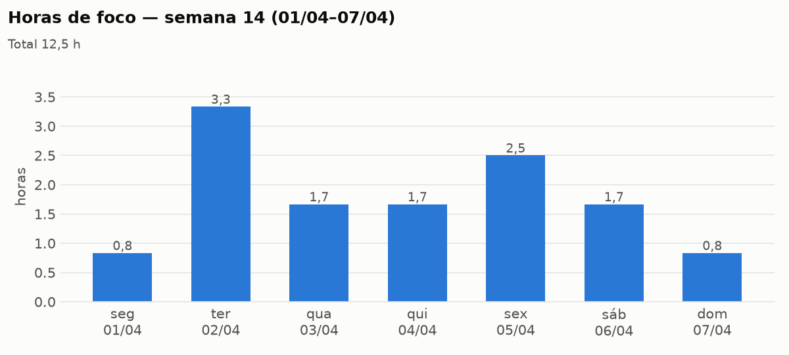
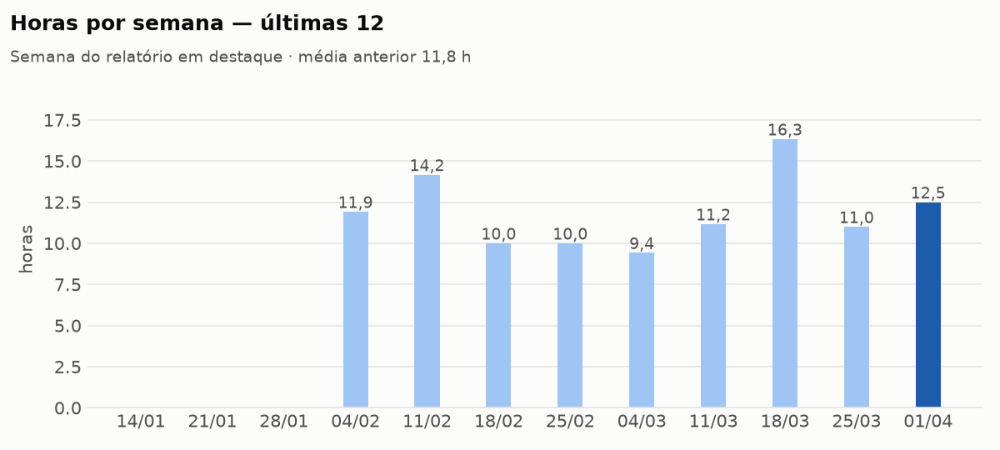

# Relatório semanal — 2030-W14 (01/04–07/04)

> Fontes: tabela de foco até 2030-04-07; registros dos projetos; diários de 2030-04-01 a 2030-04-05.

## Horas de foco

Os números estão nos gráficos; a categoria com mais horas foi `codigo`.

## Projetos
- **horta-sensores**: leitura pelo MQTT estável; sensor 2 com defeito ainda sem causa.
- **leitor-rss**: sem registro na semana.

## O que faltou registrar
- Dois dias úteis sem diário.
